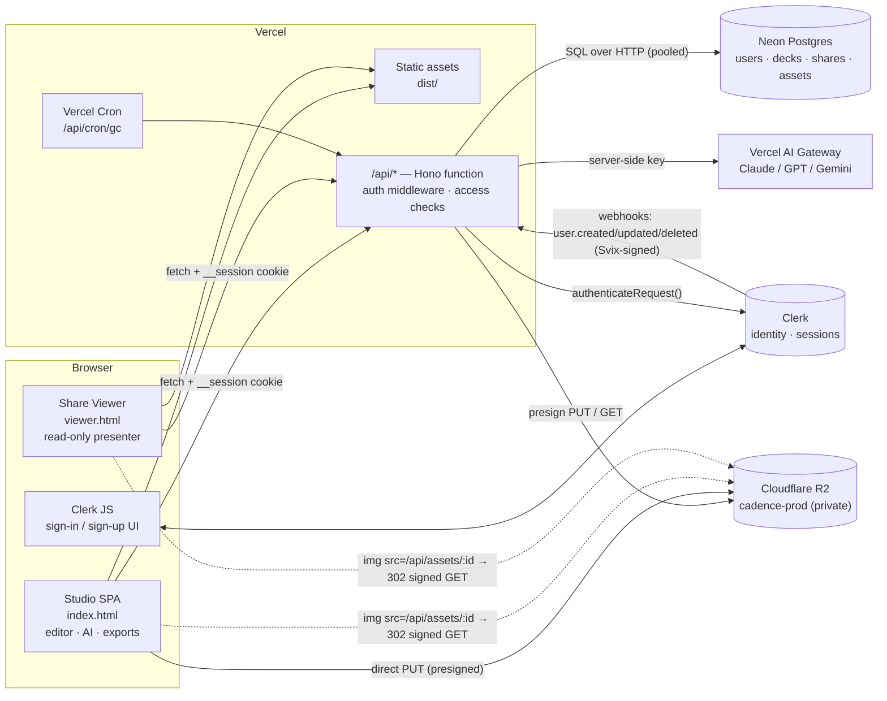
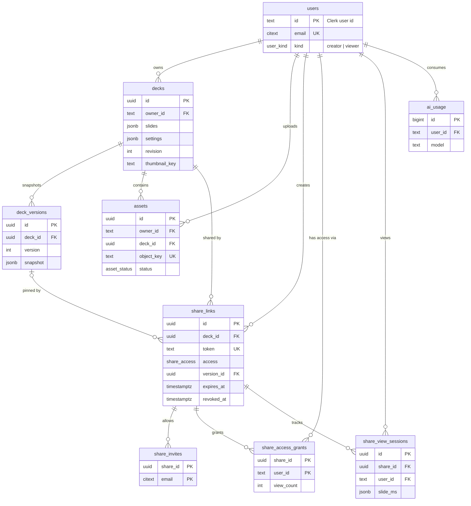
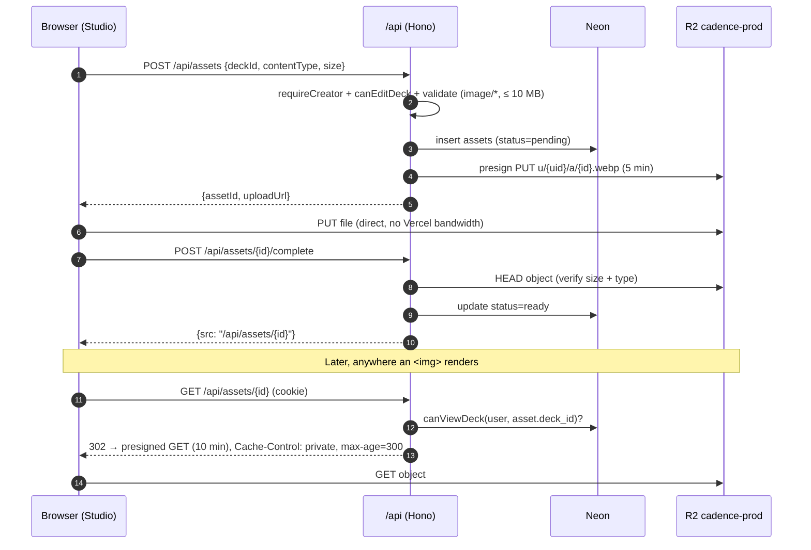
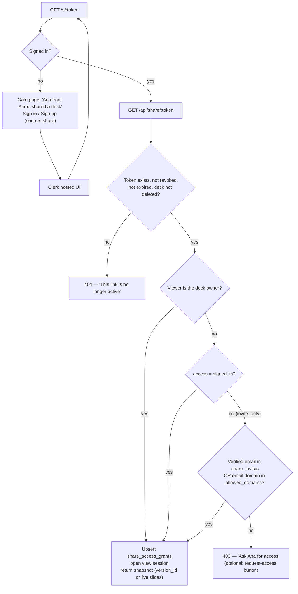
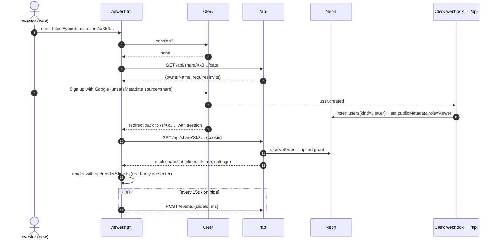
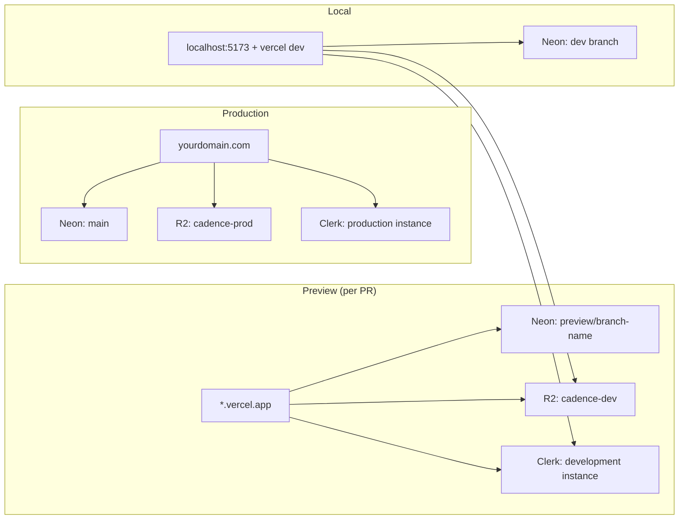

# Cadence — Production Architecture

**Stack:** Vercel (hosting + functions) · Neon Postgres (data) · Clerk (auth) · Cloudflare R2 (objects) · Vercel AI Gateway (models)

---

## 1. Where the app is today

Cadence is a **client-only Vite + vanilla TypeScript SPA**. Everything happens in the browser:

| Concern | Today | File |
| --- | --- | --- |
| Deck storage | One deck in `localStorage` (`cadence.deck.v1`) | `src/store.ts:203` |
| AI | Browser calls providers directly with the user's key from `localStorage` (`cadence.ai.v1`). Anthropic uses `anthropic-dangerous-direct-browser-access`. | `src/ai/client.ts`, `src/ai/config.ts` |
| Images | `ImageSpec.src` is a plain remote URL (Unsplash) | `src/model/types.ts:62` |
| Exports | All client-side: PPTX, PDF, PNG, HTML, MD, JSON | `src/export/*` |
| Users / sharing | None | — |

**What you have to change for production:**

1. Decks live in Neon, not `localStorage`. Users can have more than one deck.
2. Model calls go through a server proxy. API keys never reach the browser.
3. Uploaded images go to R2 and are served behind an access check.
4. Clerk handles identity, and Postgres handles authorization (who owns what and who can see what).
5. Share links that only open after the viewer signs in, for a second category of user (viewers).

**What stays the same:** the layout engine (`src/render`), themes, prompts, normaliser and every exporter. Exports stay client-side, so you don't need a server-side renderer.

---

## 2. Target architecture

### Decisions

| Decision | Choice | Why |
| --- | --- | --- |
| Frontend | Keep Vite. Build two entries: `index.html` (studio) and `viewer.html` (share viewer). | The viewer doesn't ship `pptxgenjs`, the inspector or the AI code. The share page loads fast and exposes less. |
| Backend | One Vercel Function, `api/[...route].ts`, running **Hono** | One router, one auth middleware, one DB client. You don't need to migrate to Next.js. |
| DB access | `@neondatabase/serverless` + **Drizzle ORM** (`neon-http` driver) | HTTP queries suit serverless, and Drizzle gives typed queries and migrations. |
| Auth (browser) | `@clerk/clerk-js` (vanilla) | No React needed. It mounts sign-in and sign-up into a div. |
| Auth (server) | `@clerk/backend` → `authenticateRequest()` (or `@hono/clerk-auth`) | Verifies the `__session` cookie or Bearer token on every API call. |
| Storage | R2 through the S3 API (`@aws-sdk/client-s3` + `s3-request-presigner`) | Browsers upload directly with presigned PUT URLs. Reads go through an auth-checked redirect. |
| AI | Server calls Vercel AI Gateway with `AI_GATEWAY_API_KEY` | Keys stay secret. You get metering, rate limits and model allow-listing. |
| Deck document | Whole `Deck` as JSONB (`slides`, `settings`) on one row, plus a `revision` counter | Matches the current `Deck` type 1:1. Saves are atomic. Undo stays client-side. |

### System diagram



### Target repo layout

```
api/
  [...route].ts            Hono app → export default handle(app)
  _lib/
    db.ts                  drizzle(neon(DATABASE_URL))
    auth.ts                requireUser(), requireCreator() middleware
    access.ts              canEditDeck(), canViewDeck(), resolveShare()
    r2.ts                  S3Client + presignPut/presignGet
    ai.ts                  server port of src/ai/client.ts (gateway only)
  routes/
    me.ts decks.ts versions.ts shares.ts viewer.ts assets.ts ai.ts webhooks.ts cron.ts
db/
  schema.ts                Drizzle schema (mirrors §3)
  migrations/              drizzle-kit output
src/                       existing code, plus:
  app/router.ts            /, /d/:id, /sign-in, /sign-up
  app/auth.ts              Clerk init, getToken(), guards
  app/api.ts               typed fetch wrapper (401 → sign-in, 409 → conflict UI)
  app/dashboard.ts         deck list
  viewer/main.ts           share viewer entry (reuses render/ + ui/presenter)
viewer.html                second Vite entry
vercel.json
drizzle.config.ts
```

`vite.config.ts` → `build.rollupOptions.input = { main: 'index.html', viewer: 'viewer.html' }` and change `base` from `'./'` to `'/'`. Deep routes like `/d/:id` need absolute asset paths.

---

## 3. Database schema (Neon Postgres)

Users are keyed by the **Clerk user ID** (`user_2x…`), so you don't need a mapping table. The Clerk webhook populates the `users` table (§5).

```sql
create extension if not exists citext;

create type user_kind    as enum ('creator', 'viewer');
create type share_access as enum ('signed_in', 'invite_only');
create type asset_status as enum ('pending', 'ready', 'deleted');

-- ─────────────────────────── identity ───────────────────────────
create table users (
  id          text primary key,                 -- Clerk user id
  email       citext not null,                  -- primary verified email
  name        text,
  image_url   text,
  kind        user_kind not null default 'viewer',
  created_at  timestamptz not null default now(),
  updated_at  timestamptz not null default now(),
  deleted_at  timestamptz
);
create unique index users_email_uq on users (email) where deleted_at is null;

-- ─────────────────────────── decks ──────────────────────────────
create table decks (
  id            uuid primary key default gen_random_uuid(),
  owner_id      text not null references users (id),
  title         text not null default 'Untitled deck',
  subtitle      text not null default '',
  theme         text not null default 'obsidian',
  archetype     text not null default 'pitch',
  settings      jsonb not null default '{}'::jsonb,   -- DeckSettings
  slides        jsonb not null default '[]'::jsonb,   -- Slide[]
  slide_count   int generated always as (jsonb_array_length(slides)) stored,
  revision      int not null default 1,               -- optimistic concurrency
  thumbnail_key text,                                  -- R2 key of cover thumbnail
  created_at    timestamptz not null default now(),
  updated_at    timestamptz not null default now(),
  deleted_at    timestamptz                            -- soft delete / trash
);
create index decks_owner_idx on decks (owner_id, updated_at desc) where deleted_at is null;

-- Named, immutable snapshots ("v3 – sent to investors").
create table deck_versions (
  id          uuid primary key default gen_random_uuid(),
  deck_id     uuid not null references decks (id) on delete cascade,
  version     int  not null,
  label       text,
  snapshot    jsonb not null,                          -- full Deck object
  created_by  text not null references users (id),
  created_at  timestamptz not null default now(),
  unique (deck_id, version)
);

-- ─────────────────────────── files ──────────────────────────────
create table assets (
  id            uuid primary key default gen_random_uuid(),
  owner_id      text not null references users (id),
  deck_id       uuid references decks (id) on delete set null,
  object_key    text not null unique,                  -- key inside the R2 bucket
  content_type  text not null,
  byte_size     bigint not null,
  width         int,
  height        int,
  status        asset_status not null default 'pending',
  created_at    timestamptz not null default now()
);
create index assets_deck_idx  on assets (deck_id);
create index assets_owner_idx on assets (owner_id, created_at desc);

-- ─────────────────────────── sharing ────────────────────────────
create table share_links (
  id               uuid primary key default gen_random_uuid(),
  deck_id          uuid not null references decks (id) on delete cascade,
  token            text not null unique,               -- 22-char base62, 128-bit random
  created_by       text not null references users (id),
  name             text,                               -- "Sequoia — Series A"
  access           share_access not null default 'signed_in',
  allowed_domains  citext[] not null default '{}',     -- e.g. {'sequoiacap.com'} (invite_only)
  version_id       uuid references deck_versions (id), -- null = always show latest
  allow_download   boolean not null default false,
  show_notes       boolean not null default false,
  expires_at       timestamptz,
  revoked_at       timestamptz,
  created_at       timestamptz not null default now()
);
create index share_links_deck_idx on share_links (deck_id);

-- Explicit invitees for access = 'invite_only'.
create table share_invites (
  share_id    uuid not null references share_links (id) on delete cascade,
  email       citext not null,
  invited_at  timestamptz not null default now(),
  primary key (share_id, email)
);

-- Who has actually opened a share. Doubles as the access grant for assets.
create table share_access_grants (
  share_id         uuid not null references share_links (id) on delete cascade,
  user_id          text not null references users (id) on delete cascade,
  first_viewed_at  timestamptz not null default now(),
  last_viewed_at   timestamptz not null default now(),
  view_count       int not null default 1,
  primary key (share_id, user_id)
);
create index share_grants_user_idx on share_access_grants (user_id);

-- Per-visit analytics (time per slide, completion).
create table share_view_sessions (
  id            uuid primary key default gen_random_uuid(),
  share_id      uuid not null references share_links (id) on delete cascade,
  user_id       text not null references users (id) on delete cascade,
  started_at    timestamptz not null default now(),
  last_ping_at  timestamptz not null default now(),
  slide_ms      jsonb not null default '{}'::jsonb,   -- { "<slideId>": ms }
  max_slide     int not null default 0,
  user_agent    text,
  country       text                                  -- from x-vercel-ip-country
);
create index share_sessions_share_idx on share_view_sessions (share_id, started_at desc);

-- ─────────────────────────── ops ────────────────────────────────
create table ai_usage (
  id             bigint generated always as identity primary key,
  user_id        text not null references users (id),
  deck_id        uuid references decks (id) on delete set null,
  operation      text not null,      -- compose | outline | rewrite_slide | add_slide | deck_op
  model          text not null,
  input_tokens   int,
  output_tokens  int,
  ok             boolean not null,
  created_at     timestamptz not null default now()
);
create index ai_usage_user_idx on ai_usage (user_id, created_at desc);

create table webhook_events (        -- idempotency for Clerk/Svix retries
  id           text primary key,     -- svix-id header
  type         text not null,
  received_at  timestamptz not null default now()
);
```

### ER diagram



### Small model change in the app

```ts
// src/model/types.ts
export interface ImageSpec {
  src: string          // for uploads: "/api/assets/<assetId>"
  assetId?: string     // set when the image lives in R2
  ...
}
```

Store the stable `/api/assets/:id` path in `src`, never a presigned URL. Presigned URLs expire, and a stored one would break the deck later.

### Neon setup

- **One project**, with the `main` branch for production.
- Install the **Neon ↔ Vercel integration**. Every Preview deployment gets its own Neon branch, with `DATABASE_URL` injected automatically.
- `DATABASE_URL` is the **pooled** string (`-pooler` host). Use it at runtime.
- `DATABASE_URL_UNPOOLED` is the direct string. Use it only for `drizzle-kit migrate` (CI or the Vercel build step).
- Run migrations in the build: `"vercel-build": "drizzle-kit migrate && npm run build"`.

---

## 4. Object storage (Cloudflare R2)

### How many buckets: **2** (one per environment)

| Bucket | Used by | Public access |
| --- | --- | --- |
| `cadence-prod` | Production deployment | **Off.** Private, presigned URLs only. |
| `cadence-dev` | Local dev and all Vercel Preview deployments | **Off** |

You don't need a public bucket. Theme fonts come from Google Fonts and static files from Vercel's CDN. Pitch-deck images are confidential, so they must not sit on a public URL that anyone can forward. Add a third public bucket (`cadence-public` on `cdn.yourdomain.com`) only if you later ship public templates or marketing media.

Separate prod and dev with buckets, not prefixes, so a preview deploy can never read or delete production files.

### Key layout inside a bucket

```
u/{userId}/a/{assetId}.{ext}          user-uploaded images (slide images, logos)
d/{deckId}/thumb.webp                 deck cover thumbnail for the dashboard (overwritten)
d/{deckId}/v/{version}/thumb.webp     thumbnail per named version (optional)
x/{userId}/{exportId}.{ext}           server-stored exports (future; 7-day lifecycle rule)
```

### Pointing the app at R2

1. Cloudflare → R2 → create `cadence-prod` and `cadence-dev`.
2. R2 → **Manage API tokens** → create one token per bucket with **Object Read & Write** scoped to that bucket only. You get an access key ID and a secret.
3. Set the CORS policy on each bucket. Browsers upload directly, and the exporters (`html-to-image`, PPTX) fetch images:

```json
[
  {
    "AllowedOrigins": ["https://yourdomain.com", "https://*.vercel.app", "http://localhost:5173"],
    "AllowedMethods": ["GET", "PUT", "HEAD"],
    "AllowedHeaders": ["content-type", "content-length"],
    "ExposeHeaders": ["etag"],
    "MaxAgeSeconds": 3600
  }
]
```

(Use only the prod domain on `cadence-prod`. Use the localhost and `*.vercel.app` origins on `cadence-dev`.)

4. Lifecycle rule: delete `x/` after 7 days.
5. Server client:

```ts
// api/_lib/r2.ts
import { S3Client, PutObjectCommand, GetObjectCommand } from '@aws-sdk/client-s3'
import { getSignedUrl } from '@aws-sdk/s3-request-presigner'

export const r2 = new S3Client({
  region: 'auto',
  endpoint: `https://${process.env.R2_ACCOUNT_ID}.r2.cloudflarestorage.com`,
  credentials: {
    accessKeyId: process.env.R2_ACCESS_KEY_ID!,
    secretAccessKey: process.env.R2_SECRET_ACCESS_KEY!,
  },
})
const Bucket = process.env.R2_BUCKET!

export const presignPut = (Key: string, ContentType: string, ContentLength: number) =>
  getSignedUrl(r2, new PutObjectCommand({ Bucket, Key, ContentType, ContentLength }), { expiresIn: 300 })

export const presignGet = (Key: string) =>
  getSignedUrl(r2, new GetObjectCommand({ Bucket, Key }), { expiresIn: 600 })
```

### Upload and read flow



Because `/api/assets/:id` is same-origin, the Clerk cookie goes along automatically. The same URL works in the editor, the share viewer, `html-to-image` (PNG/PDF) and the PPTX exporter. The **standalone HTML** export must inline images as data URIs so the file still works offline.

---

## 5. Authentication and authorization

### Two kinds of user, one Clerk application

Use **one** Clerk instance. A second Clerk app would split identities: a founder who is also an investor would end up with two accounts. Store the category as a role:

| Kind | Who | Can do |
| --- | --- | --- |
| `creator` | Signed up from the main site | Create, edit and AI-generate decks, upload, share, see analytics |
| `viewer` | Signed up through a share link | Open decks shared with them, and nothing else. Sees an "Upgrade to create" CTA. |

How it's assigned:

1. The share-page sign-up passes `unsafeMetadata: { source: 'share', shareToken }`. The main-site sign-up passes `{ source: 'app' }`.
2. The `user.created` webhook inserts into `users` with `kind = source === 'share' ? 'viewer' : 'creator'`. It also calls `clerk.users.updateUserMetadata(id, { publicMetadata: { role: kind } })`.
3. In Clerk → **Sessions → Customize session token**, add claims so the API reads them without a DB hit:
   ```json
   { "role": "{{user.public_metadata.role}}", "email": "{{user.primary_email_address}}" }
   ```
4. `POST /api/me/upgrade` turns a viewer into a creator by updating both the DB row and `publicMetadata`.

**Roles gate features. They never decide which deck someone can see.** Deck access always comes from Postgres (`owner_id`, `share_links`, `share_invites`, `share_access_grants`).

### Clerk setup checklist

- Production instance on **your own domain**. Clerk production needs DNS records (`clerk.yourdomain.com`, etc.), and it does **not** work on `*.vercel.app`.
- Sign-in methods: Email code plus Google. Investors almost always use Google Workspace.
- Require a **verified email**. `invite_only` shares match on it.
- Webhook endpoint `https://yourdomain.com/api/webhooks/clerk` for `user.created`, `user.updated` and `user.deleted`, verified with `svix` and `CLERK_WEBHOOK_SIGNING_SECRET`.
- Set `authorizedParties: ['https://yourdomain.com']` in `authenticateRequest` to block CSRF-style token reuse.

### Every authentication point

| # | Route | Who | Check |
| --- | --- | --- | --- |
| **Frontend** | | | |
| F1 | `/` dashboard, `/d/:id` editor | creator | Clerk loaded and signed in, otherwise `/sign-in?redirect_url=…`. A viewer gets the upgrade screen. |
| F2 | `/s/:token` share viewer | any signed-in user | Signed out → gate page → Clerk sign-in/up with `redirectUrl=/s/:token` and `unsafeMetadata.source='share'` |
| F3 | `/sign-in`, `/sign-up` | public | — |
| **API: public** | | | |
| A1 | `POST /api/webhooks/clerk` | Clerk | Svix signature plus an idempotency row in `webhook_events` |
| A2 | `GET /api/share/:token/gate` | anyone | Returns only `{ownerName, brand, requiresInvite}`, no title or slides |
| A3 | `GET /api/cron/*` | Vercel Cron | `Authorization: Bearer ${CRON_SECRET}` |
| **API: signed-in (any kind)** | | | |
| A4 | `GET /api/me` | user | Session |
| A5 | `GET /api/share/:token` | user | `resolveShare()` (below) → upsert grant → returns deck or version snapshot |
| A6 | `POST /api/share/:token/events` | user | Has a grant on this share. Updates `share_view_sessions` (beacon every 15 s and on `visibilitychange`). |
| A7 | `GET /api/assets/:id` | user | Owner **or** active grant on a share of `asset.deck_id` |
| A8 | `POST /api/me/upgrade` | viewer | Session |
| **API: creator only** | | | |
| A9 | `GET/POST /api/decks`, `GET/PUT/DELETE /api/decks/:id` | creator | `role=creator` and `owner_id = userId`. `PUT` requires `If-Match: <revision>` and returns 409 on mismatch. |
| A10 | `POST/GET /api/decks/:id/versions` | creator | owner |
| A11 | `POST/GET/PATCH/DELETE /api/decks/:id/shares` | creator | owner |
| A12 | `GET /api/decks/:id/shares/:sid/analytics` | creator | owner |
| A13 | `POST /api/assets`, `POST /api/assets/:id/complete` | creator | owner of the target deck |
| A14 | `POST /api/ai/{compose,outline,rewrite-slide,add-slide,deck-op}` | creator | Session + rate limit (e.g. 30/hour and N per day from `ai_usage`) + model allow-list |

### Share-link resolution (`resolveShare`)





**Race to handle:** the user can land back on `/s/:token` before the `user.created` webhook arrives. In `requireUser`, if there is no `users` row yet, upsert it from the session claims and treat `kind` as `viewer` unless the claim says otherwise. The webhook then just reconciles.

### Share-link rules

- Tokens come from `crypto.getRandomValues` (16 bytes → base62). Never expose `deck_id` in a share URL.
- Revocation takes effect immediately, because every view and asset fetch re-checks `revoked_at` and `expires_at`.
- `version_id` lets a founder send a frozen "v3" while they keep editing. If it's null, viewers see live slides.
- `allow_download` only hides the export buttons in the viewer. Rendering is client-side, so a determined viewer can still screenshot. Say so in the UI rather than calling it DRM.
- Speaker notes are stripped server-side unless `show_notes = true`.

---

## 6. AI on the server

Port `callModel` from `src/ai/client.ts` to `api/_lib/ai.ts`, using only the gateway (`https://ai-gateway.vercel.sh/v1`) and `AI_GATEWAY_API_KEY`. Prompt construction can stay shared, since `src/ai/prompts.ts` is pure. The browser then sends `{ operation, deckId, request }`, and the server builds the prompt, calls the model and returns the normalised JSON.

- **Delete** the browser key path, the `anthropic-dangerous-direct-browser-access` header and the Settings key field (or keep BYO-key as an explicit power-user option).
- Allow-list the models (`anthropic/claude-sonnet-4.5`, etc.). Never pass an arbitrary client-supplied slug through.
- Log every call to `ai_usage`. Enforce per-user quotas there, or add Upstash Redis for burst rate limiting.
- Set `maxDuration` high enough for full-deck generation (see `vercel.json`). Stream the response later to improve perceived speed.
- The offline composer (`src/ai/fallback.ts`) remains the fallback when quota runs out.

---

## 7. Saving decks

- On load: `GET /api/decks/:id` → `store.setDeck()`. Keep `localStorage` as a crash or offline buffer keyed by deck ID.
- On change: debounce for about 1.5 s, then `PUT /api/decks/:id` with `If-Match: revision`. The server runs `UPDATE … SET slides=$1, settings=$2, …, revision = revision + 1 WHERE id=$id AND owner_id=$uid AND revision=$rev`. If 0 rows change, it returns 409 and the client offers "Reload / Overwrite".
- Cap the payload at about 1 MB. Images are references, not base64. Reject `data:` URLs in `image.src` on the server.
- Thumbnail: after a save, at most once a minute, render slide 1 with `html-to-image` → upload `d/{deckId}/thumb.webp` → set `decks.thumbnail_key`.
- "Save version" → insert a `deck_versions` row with `snapshot = full deck` and `version = max + 1`.

---

## 8. Vercel configuration

```jsonc
// vercel.json
{
  "buildCommand": "npm run vercel-build",
  "outputDirectory": "dist",
  "functions": { "api/[...route].ts": { "maxDuration": 300 } },
  "rewrites": [
    { "source": "/s/:token", "destination": "/viewer.html" },
    { "source": "/((?!api/|assets/).*)", "destination": "/index.html" }
  ],
  "headers": [
    { "source": "/(.*)", "headers": [
      { "key": "X-Frame-Options", "value": "DENY" },
      { "key": "Referrer-Policy", "value": "strict-origin-when-cross-origin" },
      { "key": "X-Content-Type-Options", "value": "nosniff" }
    ]},
    { "source": "/s/(.*)", "headers": [{ "key": "X-Robots-Tag", "value": "noindex" }] }
  ],
  "crons": [{ "path": "/api/cron/gc", "schedule": "0 3 * * *" }]
}
```

**Nightly GC cron:** delete `assets` rows still `pending` after 24 h, along with their R2 objects. It also removes `ready` assets that no deck or version has referenced for 7 days, and soft-deleted decks after 30 days.

### Environment variables

| Variable | Where | Notes |
| --- | --- | --- |
| `DATABASE_URL` | server | Neon pooled. Set per branch by the integration. |
| `DATABASE_URL_UNPOOLED` | build | migrations only |
| `VITE_CLERK_PUBLISHABLE_KEY` | browser | `pk_live_…` (prod), `pk_test_…` (preview/dev) |
| `CLERK_SECRET_KEY` | server | `sk_live_…` |
| `CLERK_WEBHOOK_SIGNING_SECRET` | server | `whsec_…` |
| `R2_ACCOUNT_ID` | server | |
| `R2_ACCESS_KEY_ID` / `R2_SECRET_ACCESS_KEY` | server | token scoped to that environment's bucket |
| `R2_BUCKET` | server | `cadence-prod` or `cadence-dev` |
| `AI_GATEWAY_API_KEY` | server | or use Vercel OIDC when deployed |
| `CRON_SECRET` | server | |
| `APP_ORIGIN` | server | `https://yourdomain.com`, used for `authorizedParties` and CORS |

Only `VITE_`-prefixed variables reach the browser. Nothing else may carry that prefix.

### Environments



---

## 9. Production checklist

- [ ] Rate limits on `/api/ai/*` and on asset creation, plus Vercel Firewall rules on `/api/share/*` against token brute-forcing. Tokens are 128-bit, but limit anyway.
- [ ] CSP: `default-src 'self'; img-src 'self' https://*.r2.cloudflarestorage.com https://images.unsplash.com data: blob:; font-src https://fonts.gstatic.com; connect-src 'self' https://*.clerk.accounts.dev https://clerk.yourdomain.com https://*.r2.cloudflarestorage.com; frame-ancestors 'none'`
- [ ] Validate request bodies with zod in each route. Re-run the existing deck normaliser server-side on `PUT /decks/:id`.
- [ ] Error tracking (Sentry) and Vercel Analytics.
- [ ] Turn on Neon point-in-time restore for at least 7 days on prod.
- [ ] Account deletion: `user.deleted` webhook → soft-delete the user → delete their decks, shares and R2 prefix `u/{id}/` in the cron.
- [ ] Generic OG tags on `/s/*`, so the title of a gated deck never leaks into Slack or iMessage previews.
- [ ] Initialise git and set up CI (`tsc`, build, `scripts/sweep.js`) before you connect the repo to Vercel.

## 10. Build order

1. **Foundation:** git init, the Vercel project, `vercel.json`, the Hono `api/[...route].ts` with `/api/health`, and Drizzle with the schema and the first migration.
2. **Auth:** Clerk JS in the studio, `requireUser` and `requireCreator`, the webhook → `users`, and the client router (`/`, `/d/:id`).
3. **Decks in Neon:** dashboard plus CRUD, autosave with revision checks, and a one-time import of the existing `localStorage` deck on first login.
4. **AI proxy:** move `callModel` server-side, add `ai_usage`, and remove browser keys.
5. **R2:** asset upload, the `/api/assets/:id` redirect, image upload in the inspector, and thumbnails.
6. **Sharing:** `share_links` CRUD UI, the `viewer.html` entry, the gate page, `resolveShare`, grants and invite-only rules.
7. **Analytics:** view sessions, a per-share "who viewed and for how long" panel, and named versions.
8. **Hardening:** §9 checklist, then the custom domain and Clerk production DNS → launch.
